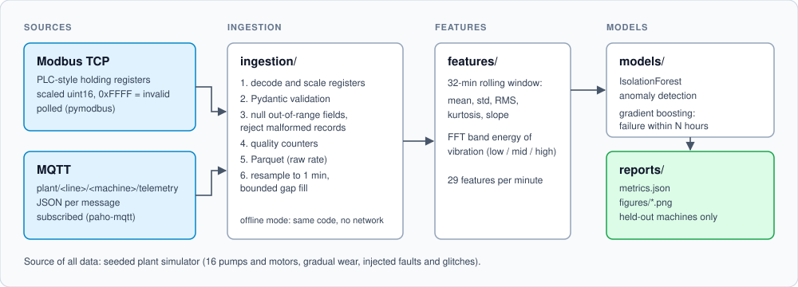
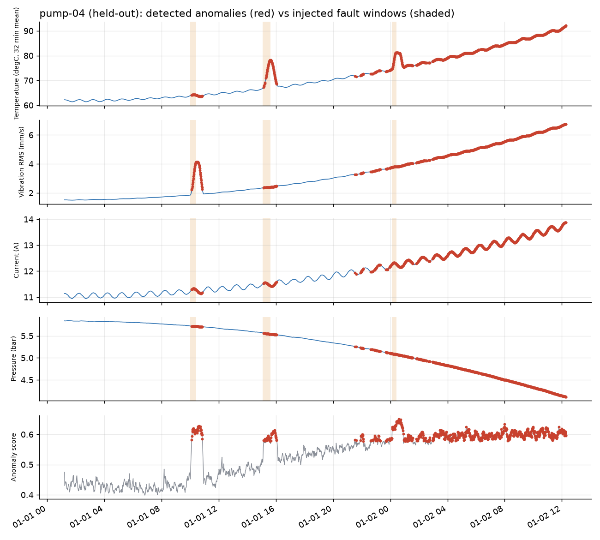
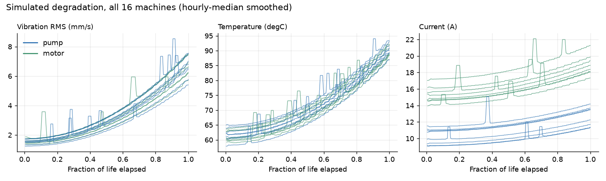
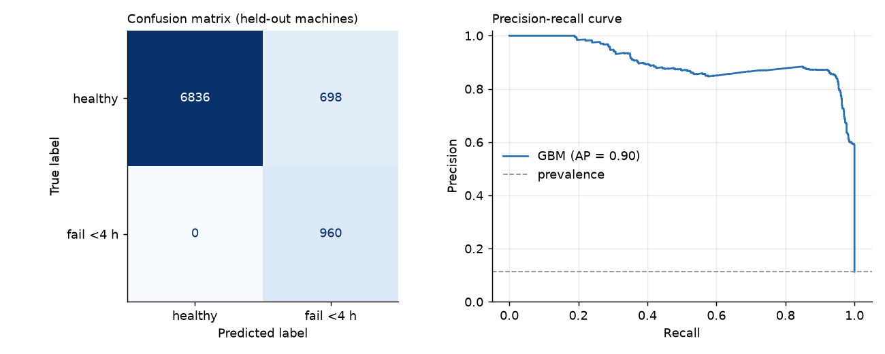
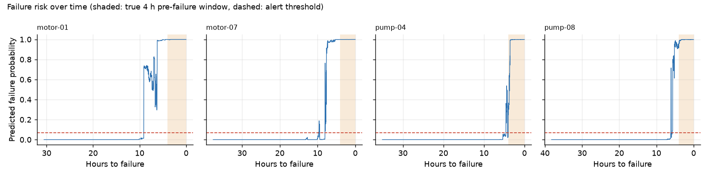

# Predictive Maintenance Telemetry

Reference implementation of a predictive-maintenance data pipeline: Modbus and MQTT telemetry ingestion, validation, resampling, feature engineering, anomaly detection and failure prediction, running end to end against a simulated plant.


> **All data in this repository is simulated.** No real plant, machine or customer data is included, and the reported metrics describe how the pipeline behaves on synthetic data, not on a real production line. The point of the repo is the pipeline engineering (protocol handling, validation, resampling, windowed features, grouped evaluation), not the headline numbers.
>
> It mirrors the kind of pipeline I worked on during an industrial AI/ML engineering internship (PLC/sensor data over Modbus and MQTT). That code is proprietary and not included here.



## Results

Everything below comes from `make demo` (seed 42, 16 machines: 8 pumps and 8 motors, run to failure over 20 to 40 simulated hours each, 10 s raw sampling). Raw output is in [`reports/metrics.json`](reports/metrics.json). Models are trained on 12 machines and evaluated on 4 machines never seen in training (2 pumps, 2 motors: `motor-01`, `motor-07`, `pump-04`, `pump-08`).

**Ingestion** (188,756 raw samples, 16 machines): 152 out-of-range values (30 current, 16 pressure, 37 rpm, 33 temperature, 36 vibration) were nulled by validation, 0 records rejected, and the 10 s samples were resampled to 31,476 one-minute rows. Missing values were counted per sensor; most of the 81,700 missing pressure values are motors, which have no pressure transducer by design.

**Failure within 4 hours (gradient boosting, held-out machines)**

| Metric | Value |
|---|---|
| ROC AUC | 0.989 |
| PR AUC (average precision) | 0.901 (positive rate 0.113) |
| Precision / recall / F1 at the chosen threshold | 0.579 / 1.000 / 0.733 |
| Confusion matrix `[[TN, FP], [FN, TP]]` | `[[6836, 698], [0, 960]]` |
| First sustained alert, hours before failure | motor-01 9.0, motor-07 8.0, pump-04 4.5, pump-08 6.0 |

The alert threshold (0.069) was picked on out-of-fold predictions of the training machines (grouped cross-validation by machine), not on the test machines. It favours recall, which is why precision is modest: 698 false-positive minutes, all of them between 4.0 and 9.7 hours before failure (checked), i.e. early warnings rather than alerts on healthy running. Out-of-fold ROC AUC on training machines was 0.997.

**Anomaly detection (IsolationForest, held-out machines)**

| Metric | Value |
|---|---|
| ROC AUC against injected fault windows (first 60% of life) | 0.849 |
| Injected fault episodes detected (at least one alarm inside the episode) | 4 of 6 |
| False-alarm rate in the healthy phase (first 30% of life, no fault) | 2.5% |
| Alarm rate in the last 10% of life | 98.7% |

The detector is fit on the first 30% of each training machine's life, treated as healthy. The last row is expected and also a limitation: an unsupervised detector cannot tell progressive wear from a transient fault, so it ends up alarming continuously near failure. Separating the two is what the supervised classifier is for.









Caveats worth stating plainly: only 4 test machines, so the numbers have wide uncertainty; the simulator's degradation is smooth and monotonic, which makes the supervised task much easier than real data would be; and the 4 h label is defined from the simulator's known failure time.

## Quickstart

Requires [uv](https://docs.astral.sh/uv/) and Python 3.12. No Docker, broker or network is needed for the demo.

```bash
uv venv --python 3.12 .venv && uv pip install -r requirements.txt

make demo     # simulate -> offline ingest -> features -> train -> figures (about 1 minute)
make test     # 17 pytest tests, no network
```

The individual steps:

```bash
make simulate   # seeded plant: ground truth and metadata in data/sim/
make ingest     # offline ingestion: decode, validate, Parquet in data/raw/, resampled in data/processed/
make train      # features, models, reports/metrics.json, reports/figures/*.png
```

### Live mode (real Modbus and MQTT sockets)

```bash
# Modbus TCP on :5020, plus MQTT if you have a broker on localhost:1883
make serve ARGS="--mqtt-host localhost"

# in a second terminal: poll Modbus, subscribe to MQTT, write Parquet parts to data/live/
.venv/bin/python -m ingestion live --modbus-host localhost --mqtt-host localhost --duration 30
```

With Docker, the compose file brings up Eclipse Mosquitto, the simulator (Modbus on 5020, MQTT to the broker) and the ingestion service writing to `./data/live`:

```bash
docker compose up --build
```

Verification status of live mode: the Modbus server and poller were run against each other on localhost (all 16 machines decoded), and the MQTT publisher and subscriber were run through a local pure-Python MQTT broker. The Docker images and the Mosquitto container were **not** built or run in the environment this was developed in, so treat `docker-compose.yml` as unverified.

## Project structure

```
common/schema.py          Modbus register map and scaling, Pydantic Reading model, clean_record()
simulator/plant.py        seeded plant: wear, injected faults, dropouts, stuck sensors, out-of-range spikes
simulator/modbus_server.py   pymodbus TCP server, 8 holding registers per machine
simulator/mqtt_publisher.py  paho-mqtt publisher, plant/<line>/<machine>/telemetry
ingestion/pipeline.py     decode -> validate -> buffer -> Parquet, with data-quality counters
ingestion/modbus_poller.py, mqtt_subscriber.py   live transports
ingestion/offline.py      in-process mode (no sockets), exercises both decode paths
ingestion/resample.py     fixed-rate resampling with bounded gap filling
features/windows.py       rolling mean/std/RMS/kurtosis/slope and FFT band energy
models/train.py           IsolationForest + gradient boosting, grouped evaluation, metrics.json
models/figures.py         figures in reports/figures/
tests/                    17 tests: register round-trip, validation, features, offline end to end
docker-compose.yml        Mosquitto + simulator + ingestion
```

## How it works

**Simulator.** Each machine is a run-to-failure trajectory generated with numpy from the seed: a wear variable grows from 0 to 1 over a random lifetime and drives temperature, vibration RMS, motor current, pressure (pumps only) and rpm, on top of a duty cycle and noise. Vibration also carries an 8-minute periodic component whose amplitude grows with wear. Transient faults (overheat, vibration burst, current spike) are injected and kept as ground truth. Communication glitches are injected separately: dropouts, frozen sensors, and absurd out-of-range spikes.

**Modbus and MQTT.** The Modbus server publishes 8 uint16 holding registers per machine, as a PLC would: a 32-bit clock across two registers, temperature in 0.1 degC, vibration in 0.001 mm/s, current and pressure in 0.01 units, rpm, a status word, and `0xFFFF` as the invalid-sensor sentinel. The poller reads contiguous ranges within the 125-register protocol limit. The MQTT side sends one JSON message per machine per step; line and machine identity come from the topic.

**Ingestion.** Both transports feed one `Ingestor`: decode and scale, validate with Pydantic, null individual out-of-range fields while keeping the rest of the record, reject records with a bad timestamp or identity, and count everything. Raw data goes to Parquet. Resampling is per machine: sort, drop duplicate timestamps, bin-mean to 1 minute, and linearly fill gaps of at most 3 bins (longer gaps stay missing; filled bins are flagged). In offline mode, line 1 goes through the register path and line 2 through the JSON path, so tests and demos cover both decoders without a broker.

**Features.** Over a 32-minute trailing window per sensor: mean, std, RMS, kurtosis, and a closed-form rolling least-squares slope. For vibration, FFT band energy (low, mid, high, as a fraction of non-DC energy) over the same window. The FFT runs on the 1-minute vibration RMS series, so it captures slow modulation, not bearing-frequency content, which would need raw high-rate acceleration.

**Models.** The IsolationForest is trained on the early life of training machines. The classifier is a histogram gradient boosting model predicting failure within 4 hours. Machines, not rows, are split into train and test, and the alert threshold comes from grouped out-of-fold predictions on the training machines.

## What I'd do next

- Validate against a real historian export, and handle real PLC quirks: byte and word order, 32-bit float registers, per-register scan rates.
- Detect stuck sensors (flat-line detection); the simulator injects them but the pipeline does not yet flag them.
- Write to TimescaleDB instead of local Parquet, with backfill and exactly-once handling for late or duplicated MQTT messages.
- Calibrate probabilities and estimate remaining useful life rather than a single binary horizon; add more machines and noisier, non-monotonic degradation so the evaluation is less optimistic.
- Add a CI workflow and run the Docker stack in CI.

## License

MIT. See [LICENSE](LICENSE).
